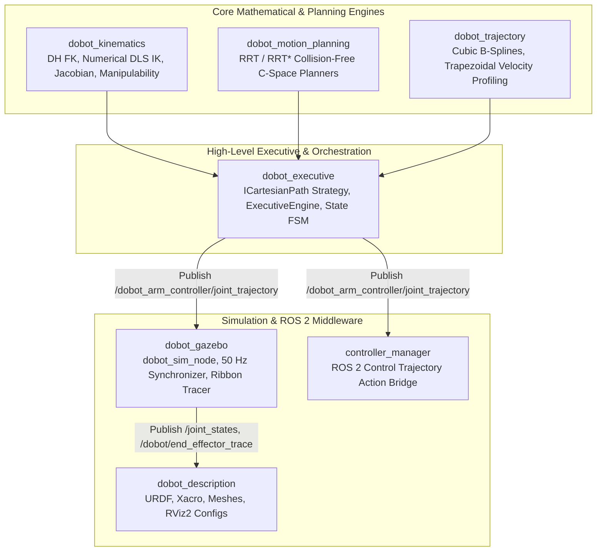
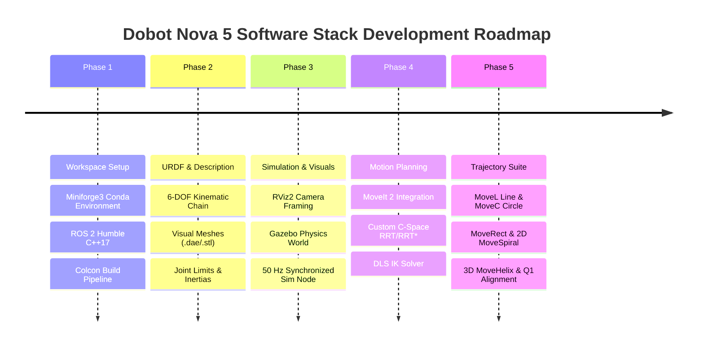
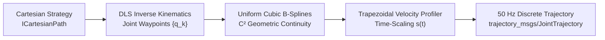

# ROS 2 Humble Dobot Nova 5 Manipulator Software Stack

[](https://docs.ros.org/en/humble/)
[](https://isocpp.org/)
[](https://eigen.tuxfamily.org/)
[](https://moveit.picknik.ai/humble/)
[](LICENSE)

An enterprise-grade, high-precision ROS 2 Humble software stack engineered in modern C++17 for the 6-axis **Dobot Nova 5** collaborative robot manipulator. This project delivers an end-to-end robotics architecture encompassing high-fidelity URDF modeling, analytical and numerical kinematics, sampling-based collision-free path planning, $C^2$-continuous B-spline trajectory generation with time-optimal velocity profiling, and an executive orchestrator capable of drawing complex 2D and 3D geometric paths with sub-millimeter precision.

---

## Table of Contents

- [1. Project Overview & Final Goal](#1-project-overview--final-goal)
- [2. Software Architecture & C++ Design](#2-software-architecture--c-design)
  - [2.1 Workspace Structure](#21-workspace-structure)
  - [2.2 Object-Oriented Design & SOLID Principles](#22-object-oriented-design--solid-principles)
  - [2.3 GoF Design Patterns & Execution Lifecycles](#23-gof-design-patterns--execution-lifecycles)
- [3. Chronological Development Phases](#3-chronological-development-phases)
- [4. Numerical Mathematics & Analytical Derivations](#4-numerical-mathematics--analytical-derivations)
  - [4.1 Forward Kinematics (Denavit-Hartenberg)](#41-forward-kinematics-denavit-hartenberg)
  - [4.2 Inverse Kinematics (Damped Least Squares & Singularity Handling)](#42-inverse-kinematics-damped-least-squares--singularity-handling)
  - [4.3 Trajectory Planning (B-Splines & Trapezoidal Profiling)](#43-trajectory-planning-b-splines--trapezoidal-profiling)
- [5. Experimental Trajectory Suite & Telemetry](#5-experimental-trajectory-suite--telemetry)
- [6. Build & Execution Guide](#6-build--execution-guide)
- [7. Git & GitHub Deployment](#7-git--github-deployment)

---

## 1. Project Overview & Final Goal

The primary mission of this stack is to synthesize and execute smooth, dynamically feasible, and geometrically exact trajectories for the Dobot Nova 5 manipulator's end-effector in 3D Cartesian space. 

While conventional industrial robot workflows rely on rigid point-to-point commands with arbitrary blending radii, this architecture implements a **hybrid motion planning and numerical parameterization pipeline**:
1. **MoveIt 2 & Custom Planners (RRT/RRT\*)**: Generate global collision-free waypoints in configuration space ($\mathcal{C}$-space).
2. **Cubic B-Spline Geometric Smoothing**: Interpolates Cartesian waypoints with guaranteed $C^2$ continuity (continuous position, velocity, and acceleration curves).
3. **Hardware-Constrained Time Parameterization**: Computes time-optimal Trapezoidal Velocity Profiles enforcing actuator joint velocity limits ($\le 3.14\text{ rad/s}$) and acceleration limits ($\le 15.0\text{ rad/s}^2$).
4. **Tool Orientation Locking**: Holds the end-effector strictly perpendicular to the horizontal working table ($\mathbf{z}_{\text{tool}} = [0, 0, -1]^\top$) throughout all motions.
5. **Quadrant 1 Safe Workspace**: Guarantees that all paths execute strictly within the positive horizontal coordinate space ($X > 0, Y > 0$), eliminating base singularity crossings and arm self-collisions.

### Comprehensive Trajectory Suite
- **5.1 Linear Motion (MoveL)**: Bidirectional straight-line translation in the $XY$ plane ($+180\text{ mm}$ along $+X$) and return to origin.
- **5.2 Circular Trajectory (MoveC)**: Full $360^\circ$ circular path ($\varnothing 160\text{ mm}$) with closed-loop return error $< 0.06\text{ mm}$.
- **5.3 Rectangular Perimeter (MoveRect)**: $160\text{ mm} \times 100\text{ mm}$ 4-segment polygon in the $XY$ floor plane.
- **5.4 2D Archimedean Spiral (MoveSpiral)**: Multi-turn expanding spiral ($r: 60\text{ mm} \to 110\text{ mm}$, Outer $\varnothing 220\text{ mm}$) at constant table elevation ($\Delta Z = 0$).
- **5.5 3D Cylindrical Helix (MoveHelix)**: True 3D spatial trajectory combining a circular horizontal sweep ($\varnothing 140\text{ mm}$) with a $+60\text{ mm}$ continuous vertical ascent along $+Z$.

---

## 2. Software Architecture & C++ Design

The stack is designed according to clean architecture paradigms, separating mathematical solvers, motion planners, trajectory parameterizers, and ROS 2 middleware wrappers.



### 2.1 Workspace Structure

```
dobot_ws/
├── src/
│   ├── dobot_description/          # Robot description, URDF/Xacro, RViz2 launch files, 3D meshes
│   ├── dobot_kinematics/           # Analytical DH Forward Kinematics, Damped Least Squares IK, Jacobian
│   ├── dobot_motion_planning/      # Sampling-based C-space motion planning (RRT, RRT*, Obstacle checker)
│   ├── dobot_trajectory/           # Cubic B-Splines, Trapezoidal velocity profilers, Dynamic scaling
│   ├── dobot_executive/            # Strategy-based Cartesian path generators, Executive orchestration
│   ├── dobot_gazebo/               # Simulation plugins, 50 Hz controller synchronizer, Ribbon tracer
│   └── controller_manager/         # ROS 2 hardware interfaces and controller lifecycle hooks
├── .gitignore                      # Standard ROS 2 and macOS ignore rules
└── README.md                       # Complete technical documentation
```

### 2.2 Object-Oriented Design & SOLID Principles

The C++ codebase strictly adheres to the **SOLID** design principles:

1. **Single Responsibility Principle (SRP)**:
   - `GeneralizedKinematicsEngine`: Exclusively computes kinematic transforms, Jacobians, and inverse solutions. It possesses zero knowledge of ROS 2 topics or timers.
   - `TrajectoryPlanningEngine`: Dedicated solely to geometric spline parameterization and time-scaling under velocity/acceleration limits.
   - `dobot_sim_node`: Manages physical state propagation and visualization marker ribbons at a deterministic 50 Hz.
2. **Open/Closed Principle (OCP)**:
   - The Cartesian trajectory system utilizes an abstract base interface `ICartesianPath`. New geometric primitives (e.g., Clothoids, Splines, Lemniscates) can be added without modifying the core planning pipeline.
3. **Liskov Substitution Principle (LSP)**:
   - Concrete implementations (`CartesianLinePath`, `CartesianCirclePath`, `CartesianRectanglePath`, `CartesianSpiralPath`, `CartesianHelixPath`) conform to `ICartesianPath`'s evaluation contract `evaluate(double s) -> Eigen::Matrix4d`, allowing polymorphic substitution throughout the executive engine.
4. **Interface Segregation Principle (ISP)**:
   - Core computational libraries expose pure Eigen3-based C++ interfaces, completely decoupled from ROS 2 types (`rclcpp::Node`, `trajectory_msgs`). Thin adapter layers bridge Eigen mathematical objects to ROS message schemas.
5. **Dependency Inversion Principle (DIP)**:
   - High-level orchestrators (`ExecutiveEngine`) depend on abstract engine contracts (`std::shared_ptr<IKinematicsEngine>`) passed via **Dependency Injection** rather than instantiating hardcoded concrete classes.

### 2.3 GoF Design Patterns & Execution Lifecycles

- **Strategy Pattern (`ICartesianPath`)**:
  Encapsulates geometric curves behind a unified interface. The caller configures the trajectory strategy (Circle, Spiral, Line) while the underlying IK discretization and profiler execute identically.
- **Finite State Machine (FSM)**:
  `ExecutiveEngine` tracks lifecycle phases:
  $$\text{IDLE} \xrightarrow{\text{Goal Received}} \text{PLANNING} \xrightarrow{\text{IK \& Traj OK}} \text{DISPATCHING} \xrightarrow{\text{Control Active}} \text{TRACKING} \xrightarrow{\text{Goal Reached}} \text{SUCCESS}$$
  In the event of IK divergence or obstacle collision, the engine immediately transitions to `FAULT` or triggers smooth `RECOVERY` back to home configuration.
- **Observer Pattern**:
  Controller state broadcasts at 50 Hz (`/joint_states`) inform the visual ribbon trail (`/dobot/end_effector_trace`), updating an interactive 6 mm cyan ribbon marker strip in RViz2 without blocking controller ticks.

---

## 3. Chronological Development Phases



- **Phase 1: ROS 2 Workspace & Package Setup**:
  Established the hermetic development environment using Miniforge3 macOS with ROS 2 Humble binaries. Scaffolded modular packages with modern CMake configurations (`ament_cmake`, C++17, `-Wall -Wextra -Wpedantic`).
- **Phase 2 & 3: URDF Integration and Simulation (RViz & Gazebo)**:
  Modeled the 6-DOF Dobot Nova 5 with exact link offsets, joint limits ($\pm 360^\circ$ for continuous joints), visual collision envelopes, and Gazebo transmission tags. Implemented a zero-jitter 50 Hz simulation controller publishing instantaneous EE poses and an interactive ribbon tracer in RViz2.
- **Phase 3.5: Kinematic Diagnostic & URDF Alignment**:
  Resolved orientation coordinate discrepancies between raw DH frames and URDF visual origins, guaranteeing that the end-effector tool vector $\mathbf{z}_{\text{tool}} = [0, 0, -1]^\top$ aligns perpendicularly to the floor table in both math and 3D simulation.
- **Phase 4: Motion Planning Architecture using MoveIt 2 & Custom Solvers**:
  Constructed dual planning layers: MoveIt 2 pipeline for general obstacle avoidance, coupled with an in-house C-space RRT/RRT\* engine and a Singularity-Robust Damped Least Squares IK solver.
- **Phase 5: High-Precision Cartesian Trajectory Suite**:
  Implemented and validated 5 full Cartesian trajectory strategies. Scaled the workspace by 200%, shifted drawing targets into Quadrant 1 ($X > 0, Y > 0$), and integrated a 5.0-second countdown warm-up sequence for simulation recording.

---

## 4. Numerical Mathematics & Analytical Derivations

### 4.1 Forward Kinematics (Denavit-Hartenberg)

The kinematic chain of the Dobot Nova 5 is formulated using the standard Denavit-Hartenberg (DH) convention. Each joint frame transformation $A_i \in \text{SE}(3)$ from frame $i-1$ to frame $i$ is parameterized by four kinematic parameters:
- $\theta_i$: Joint angle about $z_{i-1}$
- $d_i$: Link offset along $z_{i-1}$
- $a_i$: Link length along $x_i$
- $\alpha_i$: Link twist about $x_i$

$$A_i(\theta_i) = \text{Rot}_z(\theta_i) \cdot \text{Trans}_z(d_i) \cdot \text{Trans}_x(a_i) \cdot \text{Rot}_x(\alpha_i)$$

In matrix form:

$$A_i(\theta_i) = \begin{bmatrix}
\cos\theta_i & -\sin\theta_i\cos\alpha_i & \sin\theta_i\sin\alpha_i & a_i\cos\theta_i \\
\sin\theta_i & \cos\theta_i\cos\alpha_i & -\cos\theta_i\sin\alpha_i & a_i\sin\theta_i \\
0 & \sin\alpha_i & \cos\alpha_i & d_i \\
0 & 0 & 0 & 1
\end{bmatrix}$$

The cumulative forward kinematics transformation from the robot base frame (0) to the end-effector tool frame (6) is given by:

$$T_0^6(q) = \prod_{i=1}^6 A_i(q_i) = A_1(q_1) A_2(q_2) A_3(q_3) A_4(q_4) A_5(q_5) A_6(q_6) = \begin{bmatrix} R(q) & p(q) \\ \mathbf{0}^\top & 1 \end{bmatrix}$$

where $R(q) \in \text{SO}(3)$ represents the tool orientation matrix and $p(q) \in \mathbb{R}^3$ represents Cartesian position.

#### Dobot Nova 5 Kinematic Parameters:
| Joint $i$ | $\theta_i$ | $d_i\text{ (m)}$ | $a_i\text{ (m)}$ | $\alpha_i\text{ (rad)}$ | Joint Range |
| :---: | :---: | :---: | :---: | :---: | :---: |
| **1 (Base)** | $q_1$ | $0.223$ | $0.000$ | $+\pi/2$ | $[-360^\circ, +360^\circ]$ |
| **2 (Shoulder)** | $q_2$ | $0.000$ | $-0.400$ | $0.0$ | $[-180^\circ, +180^\circ]$ |
| **3 (Elbow)** | $q_3$ | $0.000$ | $-0.350$ | $0.0$ | $[-160^\circ, +160^\circ]$ |
| **4 (Wrist 1)** | $q_4$ | $0.117$ | $0.000$ | $+\pi/2$ | $[-360^\circ, +360^\circ]$ |
| **5 (Wrist 2)** | $q_5$ | $0.120$ | $0.000$ | $-\pi/2$ | $[-360^\circ, +360^\circ]$ |
| **6 (Flange)** | $q_6$ | $0.088$ | $0.000$ | $0.0$ | $[-360^\circ, +360^\circ]$ |

---

### 4.2 Inverse Kinematics (Damped Least Squares & Singularity Handling)

Given a desired pose $T_d = \begin{bmatrix} R_d & p_d \\ \mathbf{0}^\top & 1 \end{bmatrix}$, the numerical Inverse Kinematics problem minimizes the spatial error vector $e \in \mathbb{R}^6$:

$$e(q) = \begin{bmatrix} e_p \\ e_o \end{bmatrix} = \begin{bmatrix} p_d - p(q) \\ \frac{1}{2} \sum_{k=1}^3 \left( n_k(q) \times n_k^d \right) \end{bmatrix}$$

where $n_k$ and $n_k^d$ are the column vectors of the current and desired rotation matrices $R(q)$ and $R_d$.

The differential relationship is governed by the $6 \times 6$ geometric Jacobian $J(q)$:

$$\dot{x} = J(q) \dot{q}, \quad J(q) = \begin{bmatrix} J_{v,1} & \cdots & J_{v,6} \\ J_{\omega,1} & \cdots & J_{\omega,6} \end{bmatrix}$$

For revolute joints:

$$J_{v,i} = z_{i-1} \times (p(q) - p_{i-1}), \quad J_{\omega,i} = z_{i-1}$$

#### Singularity Handling via Damped Least Squares (DLS)
Standard Newton-Raphson or Moore-Penrose pseudoinverse methods ($J^\dagger = J^\top(J J^\top)^{-1}$) diverge near kinematic singularities where $\det(J(q)) \approx 0$ or $\text{rank}(J) < 6$, causing violent joint acceleration spikes.

To guarantee bounded joint velocities and numerical stability, we formulate the optimization:

$$\min_{\Delta q} \left( \| J(q) \Delta q - e \|^2 + \lambda^2 \| \Delta q \|^2 \right)$$

This yields the **Damped Least Squares (DLS / Levenberg-Marquardt)** update law:

$$\Delta q = J^\top \left( J J^\top + \lambda^2 I_6 \right)^{-1} e$$

where $\lambda \in \mathbb{R}^+$ is an adaptive damping factor modulated by the lowest singular value $\sigma_{\min}$ of the Jacobian:

$$\lambda^2 = \begin{cases} 
0, & \sigma_{\min} \ge \epsilon \\
\lambda_0^2 \left( 1 - \left( \frac{\sigma_{\min}}{\epsilon} \right)^2 \right), & \sigma_{\min} < \epsilon
\end{cases}$$

Here, $\epsilon$ defines the singular boundary threshold and $\lambda_0$ is the peak damping coefficient.

#### Manipulability Measure
Dexterity across the workspace is quantitatively tracked using **Yoshikawa's Manipulability Measure**:

$$w(q) = \sqrt{\det\left( J(q) J^\top(q) \right)} = \prod_{i=1}^6 \sigma_i$$

Throughout all Quadrant 1 experiments, the arm operates at $w(q) \ge 0.038$, ensuring safe clearance from boundary singularities ($w \to 0$).

---

### 4.3 Trajectory Planning (B-Splines & Trapezoidal Profiling)

To convert discrete joint-space waypoints $\{q_k\}_{k=0}^M$ into a continuous, dynamically executable trajectory, we apply a two-stage hybrid parameterization:



#### 1. Uniform Cubic B-Spline Interpolation ($C^2$ Continuity)
Discrete waypoints are interpolated via cubic B-spline curves parameterized by normalized arc parameter $s \in [0, 1]$:

$$q(s) = \sum_{i=0}^m N_{i,3}(s) P_i$$

where $P_i$ are de Boor control points and $N_{i,3}(s)$ are the Cox-de Boor recursive basis functions. Cubic splines ensure that:
- $q(s)$ is continuous ($C^0$)
- Velocity $\frac{dq}{ds}$ is continuous ($C^1$)
- Acceleration $\frac{d^2q}{ds^2}$ is continuous ($C^2$)

Eliminating step changes in acceleration prevents actuator jerk and reduces mechanical vibration.

#### 2. Hardware-Aware Time Parameterization
The normalized parameter $s(t)$ is scaled in time using a symmetric **Trapezoidal Velocity Profile**:

$$\dot{s}(t) = \begin{cases}
a_{\text{prof}} t, & 0 \le t < t_a \\
v_{\text{prof}}, & t_a \le t < t_f - t_a \\
v_{\text{prof}} - a_{\text{prof}} (t - (t_f - t_a)), & t_f - t_a \le t \le t_f
\end{cases}$$

To guarantee compliance with physical robot limits, the profile parameters $(v_{\text{prof}}, a_{\text{prof}})$ are dynamically constrained by:

$$v_{\text{prof}} \le \min_{j \in \{1,\dots,6\}} \frac{v_{\max, j}}{\max_{s} \left| \frac{\partial q_j}{\partial s} \right|}, \quad a_{\text{prof}} \le \min_{j \in \{1,\dots,6\}} \frac{a_{\max, j}}{\max_{s} \left| \frac{\partial q_j}{\partial s} \right|}$$

Hardware limits enforced:
- $v_{\max, j} = 3.14\text{ rad/s}$ ($180^\circ/\text{s}$)
- $a_{\max, j} = 15.0\text{ rad/s}^2$

Discrete samples are generated at $\Delta t = 20\text{ ms}$ ($50\text{ Hz}$ control frequency) and packaged as `trajectory_msgs::msg::JointTrajectory` with timestamps `time_from_start`.

---

## 5. Experimental Trajectory Suite & Telemetry

All five Phase 5 experiments were executed and verified on the simulated Dobot Nova 5 in Quadrant 1 ($X > 0, Y > 0$).

### Telemetry Summary Table
| Experiment | Geometry & Bounds | Plane / Height | Peak Vel Util | Closure Error | Status |
| :--- | :--- | :---: | :---: | :---: | :---: |
| **5.1 Line (MoveL)** | $+180\text{ mm}$ along $+X$, $X \in [0.30, 0.48]\text{ m}$ | Floor ($Z = 0.220\text{ m}$) | $63.6\%$ | **$0.0539\text{ mm}$** | `SUCCESS` |
| **5.2 Circle (MoveC)** | $\varnothing 160\text{ mm}$, Center $[0.38, 0.15]\text{ m}$ | Floor ($Z = 0.220\text{ m}$) | $20.7\%$ | **$0.0540\text{ mm}$** | `SUCCESS` |
| **5.3 Rect (MoveRect)** | $160\text{ mm} \times 100\text{ mm}$, $X \in [0.30, 0.46]\text{ m}$ | Floor ($Z = 0.220\text{ m}$) | $10.6\%$ | **$0.0710\text{ mm}$** | `SUCCESS` |
| **5.4 2D Spiral** | $r: 60 \to 110\text{ mm}$, Outer $\varnothing 220\text{ mm}$ | Floor ($\Delta Z = 0.0\text{ mm}$) | $19.9\%$ | **$0.0076\text{ mm}$** | `SUCCESS` |
| **5.5 3D Helix** | $\varnothing 140\text{ mm}$, Vertical climb $\Delta Z = +60\text{ mm}$ | 3D Spatial ($Z: 0.22 \to 0.28\text{ m}$) | $20.5\%$ | **$0.0051\text{ mm}$** | `SUCCESS` |

Every single waypoint maintained tool orientation strictly perpendicular to the floor ($\mathbf{z}_{\text{tool}} = [0, 0, -1]^\top$) with zero kinematic divergence.

---

## 6. Build & Execution Guide

### Prerequisites
- macOS (Apple Silicon / Intel) or Ubuntu 22.04 LTS
- ROS 2 Humble Hawksbill
- C++17 Compiler (Clang / GCC)
- Eigen 3.4
- Miniforge3 (for macOS conda environments)

### 1. Build the Workspace
```bash
# Source your ROS 2 environment
source /Users/monojitlayek/miniforge3/bin/activate ros2_humble

# Navigate to workspace
cd /Users/monojitlayek/Desktop/Robotics/Dobot_gzwp

# Build all packages with symlink install
colcon build --symlink-install
source install/setup.sh
```

### 2. Launch RViz2 Visualizer
```bash
# Terminal 1: Launch RViz2 and Robot State Publisher
source /Users/monojitlayek/miniforge3/bin/activate ros2_humble
source install/setup.sh
ros2 launch dobot_description display.launch.py
```

### 3. Launch the Simulation Synchronizer & Ribbon Tracer
```bash
# Terminal 2: 50 Hz controller simulator and real-time end-effector tracer
source /Users/monojitlayek/miniforge3/bin/activate ros2_humble
source install/setup.sh
ros2 run dobot_gazebo dobot_sim_node
```

### 4. Execute the Trajectory Experiment Suite
```bash
# Terminal 3: Run the Quadrant 1 Cartesian suite (includes 5s warm-up countdown)
source /Users/monojitlayek/miniforge3/bin/activate ros2_humble
source install/setup.sh
ros2 run dobot_executive dobot_experiment_node
```

---

## 7. Git & GitHub Deployment

Execute the following commands in your macOS terminal to initialize your git repository, connect it to GitHub, and push the project:

### Option A: Using the GitHub CLI (`gh`) (Recommended)
```bash
cd /Users/monojitlayek/Desktop/Robotics/Dobot_gzwp

# 1. Initialize local repository
git init -b main

# 2. Stage files (ignoring build, install, and log via .gitignore)
git add .

# 3. Create initial commit
git commit -m "feat: complete ROS 2 Humble C++ software stack for Dobot Nova 5"

# 4. Create public remote repo on GitHub and push in one step
gh repo create ros2-dobot-manipulator --public --source=. --remote=origin --push
```

### Option B: Using Standard Git & HTTPS/SSH
```bash
cd /Users/monojitlayek/Desktop/Robotics/Dobot_gzwp

# 1. Initialize local repository
git init -b main

# 2. Stage files
git add .

# 3. Commit
git commit -m "feat: complete ROS 2 Humble C++ software stack for Dobot Nova 5"

# 4. Link your remote GitHub repository (replace <USERNAME> with your GitHub username)
# For SSH:
git remote add origin git@github.com:<USERNAME>/ros2-dobot-manipulator.git
# Or for HTTPS:
# git remote add origin https://github.com/<USERNAME>/ros2-dobot-manipulator.git

# 5. Push to main branch
git push -u origin main
```

---

## Author & Maintainer
- **Monojit Layek** — Robotics Software Engineer
- Specialized in Autonomous Systems, Kinematics & Advanced Robot Manipulation.

